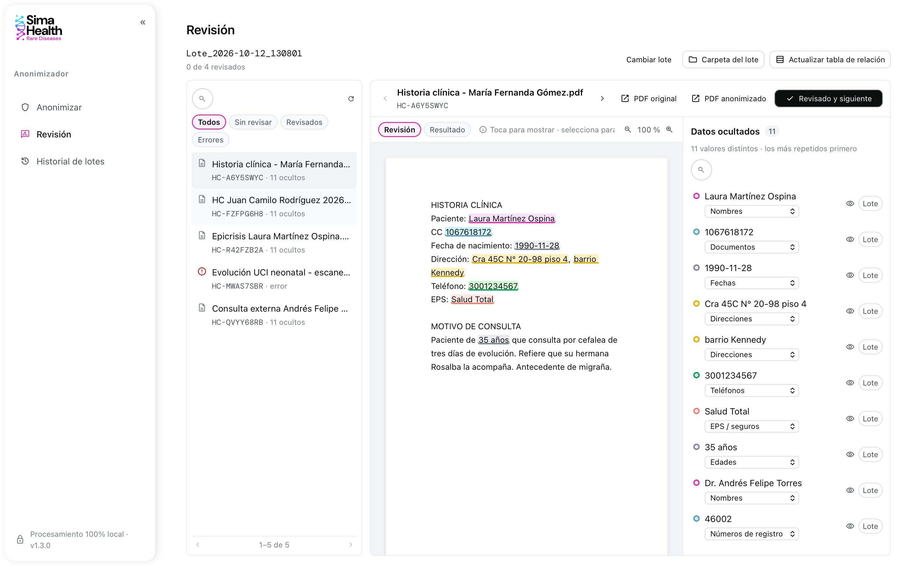
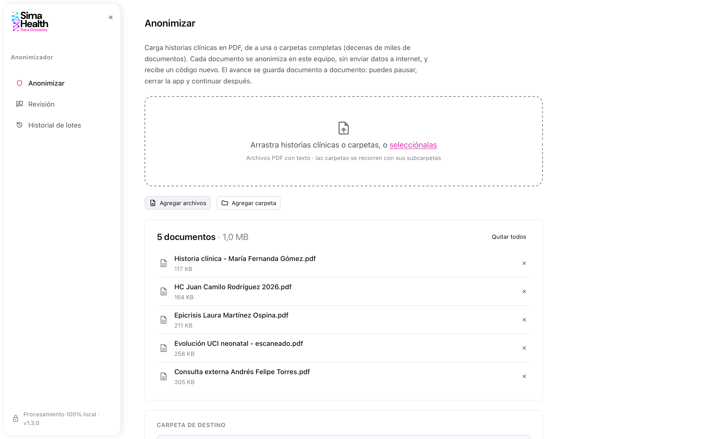
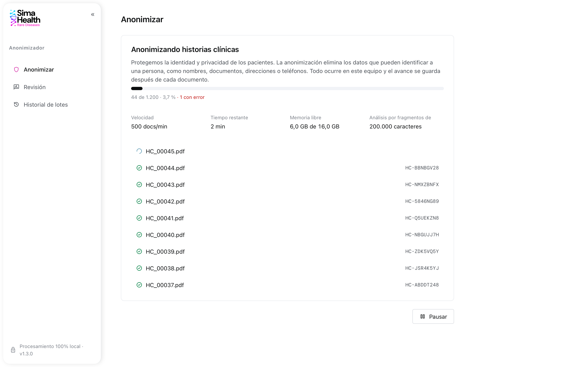
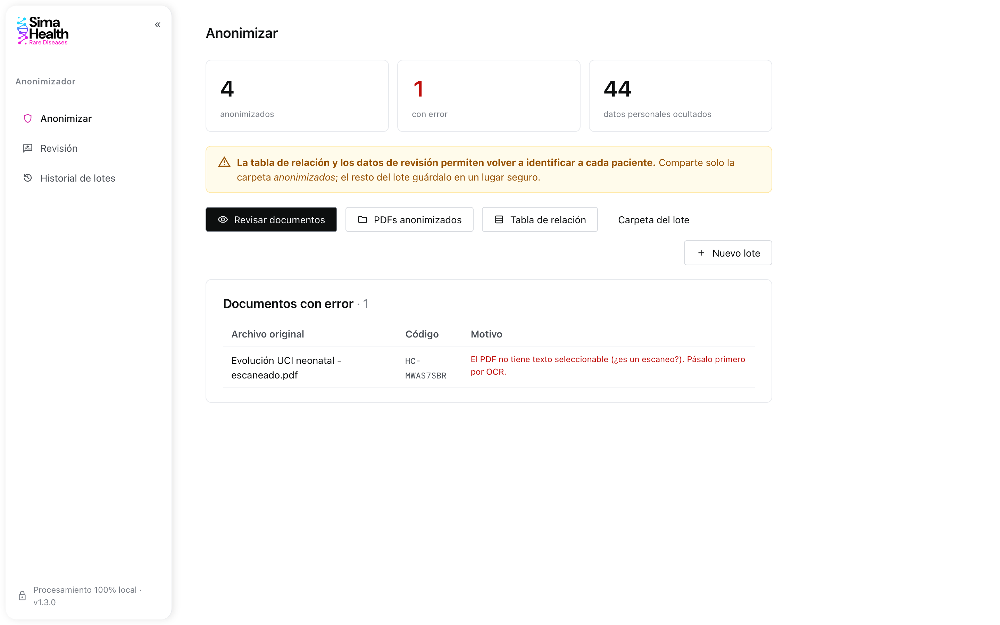

# SIMA Anonimizador

**Anonimiza historias clínicas en PDF en tu propio computador, sin enviar datos a internet.**

SIMA Anonimizador es una aplicación de escritorio para **Windows y macOS** que
oculta los datos personales de historias clínicas (nombres, documentos,
teléfonos, direcciones, correos, fechas, EPS…) para que puedan compartirse con
fines de investigación, auditoría o analítica. Procesa desde un documento hasta
**decenas de miles** en un mismo lote, y entrega una tabla que relaciona cada
archivo original con su nuevo código.



## Descargar

**[⬇ Descargar la última versión](https://github.com/Simahealth/local-anonymizer/releases/latest)**

| Tu equipo | Archivo |
| --- | --- |
| Windows 10 u 11 | `SIMA-Anonimizador-…-Windows-instalador.exe` |
| Windows, sin instalar | `SIMA-Anonimizador-Windows-portable.zip` |
| Mac con chip Apple (M1, M2, M3…) | `SIMA-Anonimizador-macOS-AppleSilicon.dmg` |
| Mac con procesador Intel | `SIMA-Anonimizador-macOS-Intel.dmg` |

¿No sabes qué Mac tienes? Manzana de la esquina superior izquierda → *Acerca de esta Mac*: si dice **Chip
Apple**, usa *AppleSilicon*; si dice **Procesador Intel**, usa *Intel*.

> **Primera vez que la abres:** la aplicación aún no está firmada con un
> certificado, así que el sistema muestra un aviso que se autoriza una sola vez.
> - **Windows:** en "Windows protegió su PC", haz clic en *Más información* →
>   *Ejecutar de todas formas*.
> - **macOS:** sigue los pasos de *Primera apertura* del manual (cambian según
>   la versión de macOS).

**Manuales de instalación paso a paso:**
[Windows](docs/INSTALACION-WINDOWS.md) · [macOS](docs/INSTALACION-MACOS.md)

**Requisitos:** Windows 10/11 de 64 bits o macOS 11 o posterior, 4 GB de RAM
(8 GB recomendado) y unos 500 MB libres. No necesita internet ni instalar nada
más: todo viene incluido.

## Cómo se usa

### 1. Carga los documentos

Arrastra archivos PDF o carpetas completas (con sus subcarpetas) a la ventana,
o usa los botones *Agregar archivos* / *Agregar carpeta*. Elige dónde guardar
el resultado.



### 2. Anonimiza

Cada documento se procesa en tu equipo y recibe un código aleatorio, como
`HC-7F3A9C21`. Puedes ver el avance, **pausar, cerrar la aplicación y
continuar después** desde el *Historial*: el progreso se guarda documento a
documento.



### 3. Revisa el resultado

Al terminar verás cuántos documentos se anonimizaron, si alguno tuvo
problemas y accesos directos a la carpeta de resultados.



### 4. Corrige lo que haga falta

En **Revisión** ves cada documento como un lector de PDF, con los datos
ocultados resaltados por color:

- **Toca algo resaltado** para mostrarlo, si no era un dato personal. Tócalo de
  nuevo para volver a ocultarlo.
- **Selecciona texto** que se haya escapado y pulsa *Ocultar* (o Enter). La
  categoría se sugiere sola.
- Aplica un cambio a **todas las apariciones** del documento, o a **todo el
  lote** de una vez.
- Marca cada documento como *Revisado* para llevar el control.

Cada cambio se guarda al instante y actualiza el PDF anonimizado.

## Qué obtienes

```
Lote_2026-10-12_143015/
├── anonimizados/            ← los PDF anonimizados: esto es lo que se comparte
│   ├── HC-7F3A9C21.pdf
│   └── …
├── relacion_codigos.xlsx    ← tabla: archivo original ↔ código  (CONFIDENCIAL)
├── relacion_codigos.csv     ← la misma tabla en CSV             (CONFIDENCIAL)
└── lote.sqlite              ← datos del lote para revisión      (CONFIDENCIAL)
```

> ⚠️ **Comparte solo la carpeta `anonimizados/`.** La tabla de relación y
> `lote.sqlite` permiten saber a qué paciente corresponde cada documento:
> guárdalos en un lugar seguro y con acceso restringido.

## Qué datos detecta

| Categoría | Ejemplos |
| --- | --- |
| Nombres | pacientes, familiares, médicos y personal de salud |
| Documentos | cédula, tarjeta de identidad, NIT |
| Teléfonos | celulares y fijos |
| Direcciones | calles, carreras, barrios, manzanas |
| Correos | incluidos los partidos o sin "@" (`usuario gmail com`) |
| Fechas y edades | nacimiento, atenciones, "35 años" |
| Registros médicos | números de registro profesional |
| Aseguradoras | EPS y otras entidades |
| Lugares | municipios y ciudades |

## Privacidad y seguridad

- **100 % local:** los documentos nunca salen de tu equipo. La aplicación no
  usa servicios en la nube ni modelos de lenguaje externos y funciona sin
  conexión a internet.
- **Ligera:** usa técnicas de procesamiento de lenguaje que corren en un
  computador de oficina, sin tarjeta gráfica.
- **Sin rastros en los PDF:** los archivos anonimizados se generan de nuevo
  desde cero, sin los metadatos del documento original.

## Qué tan precisa es

En pruebas con historias clínicas colombianas con datos ficticios, la
aplicación ocultó entre el **97 % y el 100 %** de los datos personales, según
el tipo de documento. Con nombres que nunca había visto, oculta alrededor del
**90 %**.

Ninguna herramienta automática es perfecta: **recomendamos revisar los
documentos** en la sección *Revisión* antes de compartirlos, sobre todo los
primeros de cada tipo de formato.

### Limitaciones

- **PDF escaneados (imágenes):** no tienen texto seleccionable y se reportan
  como error. Pásalos primero por un programa de OCR.
- **PDF con contraseña:** se reportan como error. Quita la contraseña antes.
- Está diseñada para historias clínicas **en español de Colombia**. Otros
  formatos (p. ej. teléfonos o direcciones de otros países) pueden detectarse
  peor.

## Para desarrolladores

Arquitectura, desarrollo local, compilación, publicación de versiones, el
modelo de nombres y la metodología de evaluación están en
[docs/DESARROLLO.md](docs/DESARROLLO.md).

---

Hecho por [SimaHealth](https://simahealth.co).
